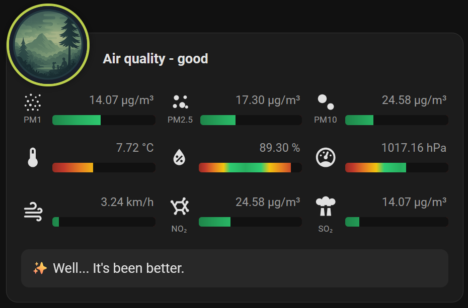
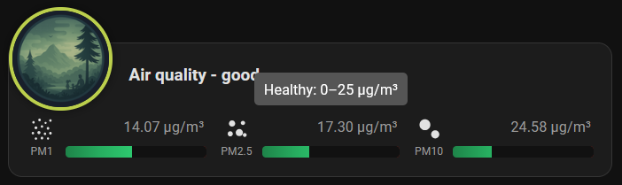

# Air Quality Card Plus

A custom Home Assistant Lovelace card designed to visualize **outdoor and indoor air quality** and weather parameters with a **CAQI-colored badge ring**, dynamic health-range gradient bars, built-in sensor presets, and a full Visual Editor.

---

## Credits & Attribution

- **Original Project:** This repository is a fork and expansion of **[UrbanTechIO/air-quality-card](https://github.com/UrbanTechIO/air-quality-card)** created by **UrbanTechIO (Rami Rihawi)**.
- **Original Inspiration:** Inspired by **[Olen/lovelace-flower-card](https://github.com/Olen/lovelace-flower-card)** by **Olen**.

---

## What Changed Compared to the Original Card?

1. **Separate Card Identity & File Paths (`custom:air-quality-card-plus`)**
   - Uses a dedicated bundle (`air-quality-card-plus.js`), element name (`air-quality-card-plus`), and image folder (`/local/air-quality-card-plus/`), so it can be installed alongside the original `air-quality-card` without any file or resource conflicts.

2. **CAQI-Colored Ring Around the Badge**
   - The 3px ring around the circular rating illustration dynamically changes color according to the European **CAQI (Common Air Quality Index)** scale:
     - `0–25` (Very Low / Excellent): `#79BC6A`
     - `26–50` (Low / Good): `#BBCF4C`
     - `51–75` (Medium / Moderate): `#EEC20B`
     - `76–100` (High / Poor): `#F29305`
     - `> 100` (Very High / Unhealthy): `#960018`
   - Uses the numeric **Air Quality Index** (`aqi`) entity when configured, or automatically falls back to the **Rating** (`rating`) state.

3. **Configurable 3 × 3 Sensor Grid (Up to 9 Sensors)**
   - Supports **3 rows** with **3 sensors per row**.
   - **Row 2** and **Row 3** can be independently enabled or disabled via toggle switches.

4. **Built-in Sensor Type Presets**
   - Selecting a **Sensor type** (`PM1`, `PM2.5`, `PM10`, `NO₂`, `O₃`, `SO₂`, `CO`, `CO₂`, `VOC`, `Temperature`, `Humidity`, `Pressure`, `Wind Speed`, `UV Index`) automatically populates the icon, icon label, tooltip, bar `Min`/`Max`, and `Green min`/`Green max` thresholds — while still allowing you to customize every field manually.

5. **Flexible Icons & Optional Label Under Icon**
   - Choose between built-in vector particle-dot icons (`PM1`, `PM2.5`, `PM10`), any **Home Assistant** icon (`mdi:...`), or a **Custom** image URL (`/local/...`).
   - Any sensor can display an optional short text label (`Icon label`) directly underneath its icon.
   - Measurement units are read automatically from each Home Assistant entity (`unit_of_measurement`).

6. **Dynamic Green Range (`Green min` / `Green max`)**
   - In addition to the bar's display scale (`Min` and `Max`), each sensor defines its healthy/comfort range (`Green min` and `Green max`). The bar's color gradient dynamically scales so the green zone matches your exact thresholds.

7. **Redesigned Visual Editor**
   - Built with native Home Assistant `<ha-selector>` components for full visual configuration without writing YAML.

---

## Screenshots

| Card & Tooltip | Recommendation Banner |
| :---: | :---: |
|  |  |

| Visual Editor |
| :---: |
|  |

---

## Installation

### 1. Badge Images (Required)
Copy the 5 rating badge images from the `img/` folder of this repository into your Home Assistant `config/www/air-quality-card-plus/` folder:
- `config/www/air-quality-card-plus/excellent.png`
- `config/www/air-quality-card-plus/good.png`
- `config/www/air-quality-card-plus/moderate.png`
- `config/www/air-quality-card-plus/poor.png`
- `config/www/air-quality-card-plus/unhealthy.png`

### 2. Card JavaScript File

#### Option A: HACS (Custom Repository)
1. Open **HACS → Frontend → ⋮ (top right) → Custom repositories**.
2. Add your GitHub repository URL and select category **Dashboard** (Lovelace).
3. Install **Air Quality Card Plus** and reload your browser.

#### Option B: Manual Installation
1. Copy `air-quality-card-plus.js` into your Home Assistant `config/www/` directory (`config/www/air-quality-card-plus.js`).
2. In Home Assistant go to **Settings → Dashboards → ⋮ (top right) → Resources → Add Resource**:
   - **URL:** `/local/air-quality-card-plus.js`
   - **Resource type:** `JavaScript Module`
3. Refresh your browser cache (`Ctrl + F5`).

---

## Configuration

You can configure the card entirely through the **Visual Editor** in Home Assistant.

### Rating Sensor Values
The `rating` entity state (case-insensitive) selects the badge illustration from `/local/air-quality-card-plus/<state>.png`:
- `excellent`
- `good`
- `moderate`
- `poor`
- `unhealthy`

---

## License

MIT License — see [LICENSE](./LICENSE).
